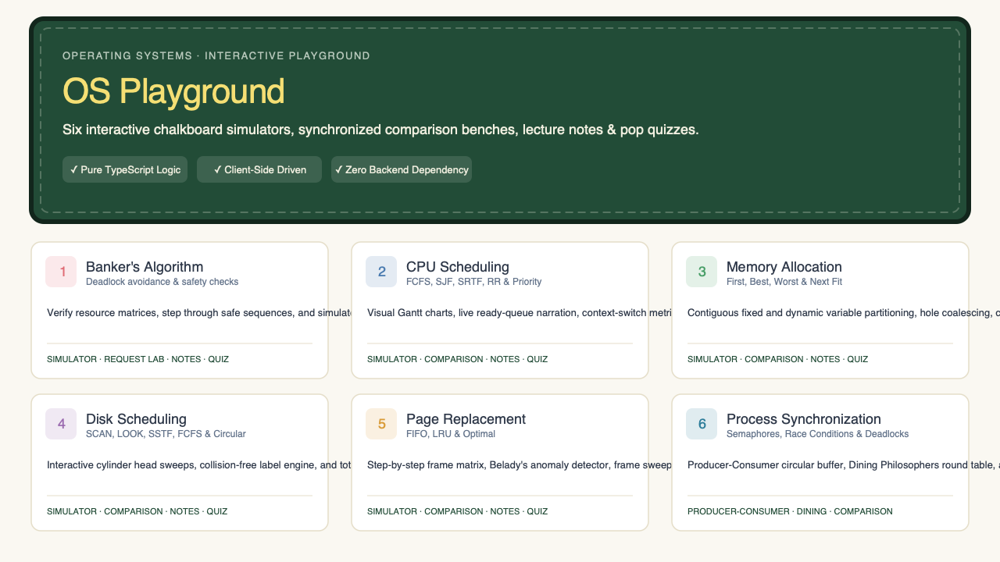
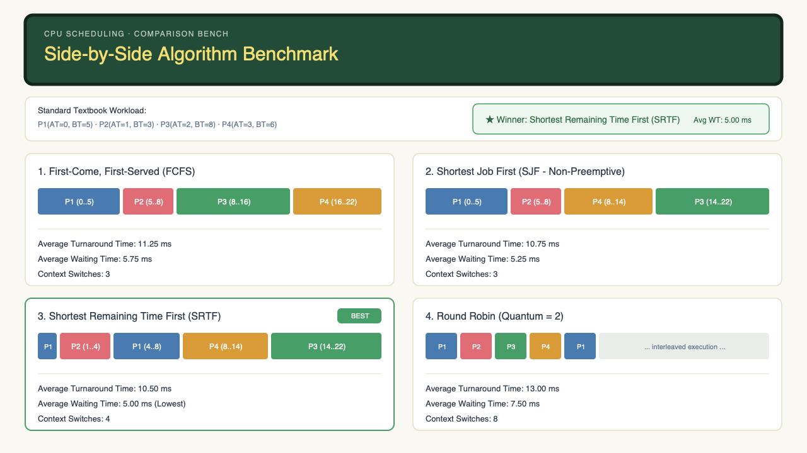
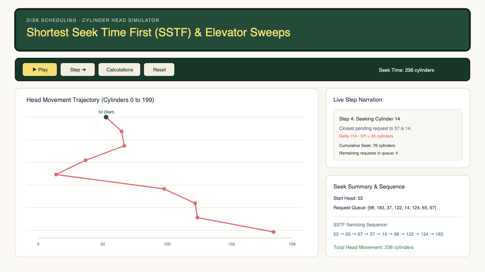
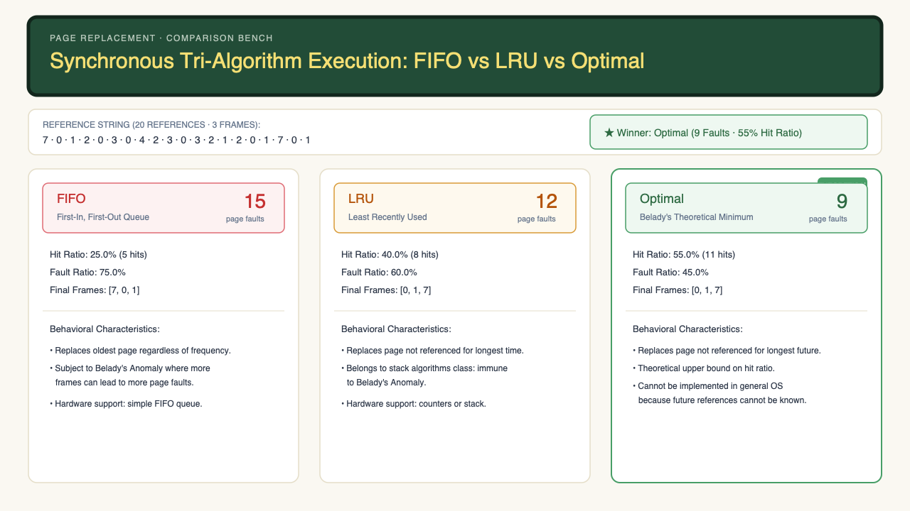

# OS Playground

```text
 ┌─────────────────────────────────────────────────────────────┐
 │  OPERATING SYSTEMS · CHALKBOARD SIMULATORS & NOTEBOOK LAB   │
 │                                                             │
 │   [1] Banker's Algorithm   ─ Deadlock avoidance & safety    │
 │   [2] CPU Scheduling       ─ FCFS, SJF, SRTF, RR, Priority  │
 │   [3] Memory Allocation    ─ Contiguous fit & fragmentation │
 │   [4] Disk Scheduling      ─ Head sweeps: SCAN, LOOK, SSTF  │
 │   [5] Page Replacement     ─ FIFO, LRU, Optimal & Belady's  │
 │   [6] Process Sync         ─ Semaphores, Dining Philo       │
 └─────────────────────────────────────────────────────────────┘
```

> **Live Demo**: [https://os-banker-s-algo.vercel.app](https://os-banker-s-algo.vercel.app)

An interactive, visual Operating Systems learning platform designed for computer science students and educators. Explore core OS concepts through hands-on step-by-step chalkboard simulators, interactive notebook lecture notes, side-by-side algorithm comparison benches, and self-assessment pop quizzes.

---

## Visual Tour

### Home & Topic Directory


### Side-by-Side Algorithm Comparisons


### Interactive Chalkboard Simulators


### Synchronous Multi-Algorithm Benchmarks


---

## Quickstart

### Prerequisites
- Node.js (v18 or newer recommended)
- npm or bun

### Setup & Development

```bash
# Clone the repository
git clone https://github.com/SakshamBompilwar/OS-Banker-s-Algo.git
cd OS-Banker-s-Algo

# Install dependencies
npm install

# Start local development server with hot reload
npm run dev

# Preview production build locally
npm run build
npm run preview
```

### Running Tests

```bash
# Run the complete test suite (unit + component UI tests)
npm test

# Run end-to-end smoke & mathematical benchmark tests
npm run test:e2e

# Run tests in watch mode
npm run test:watch
```

---

## Tech Stack & Pure Algorithmic Architecture

The application is built on a clean, decoupled architecture:

- **Framework & SSR**: React 19, TypeScript, [TanStack Start](https://tanstack.com/start) with [TanStack Router](https://tanstack.com/router)
- **Styling**: Tailwind CSS, Lucide React icons, academic chalkboard theme with paper cards and handwriting fonts (`Caveat`)
- **Testing**: [Vitest](https://vitest.dev/) and `@testing-library/react`

### The Pure-Functions Rule
A foundational design principle of this repository is that **all operating system algorithmic logic must reside strictly in pure TypeScript functions under `src/lib/*.ts` and `src/lib/sync/`**, completely decoupled from React components, hooks, or DOM APIs:

- `src/lib/bankers.ts`: Dijkstra's Banker's algorithm, safety verification, and resource-request vector arithmetic.
- `src/lib/scheduling.ts`: Pure scheduling simulation engines (FCFS, SJF, SRTF, RR, Priority Preemptive/Non-preemptive) generating deterministic timelines, metrics (TAT, WT, RT), context switch counts, and tie-break verdict comparisons (`pickBest`).
- `src/lib/memory.ts`: Contiguous memory partition managers (First Fit, Best Fit, Worst Fit, Next Fit), hole coalescing, compaction, internal/external fragmentation calculators, and strategy verdict rankers (`pickBestMemory`).
- `src/lib/disk.ts`: Pure disk arm sweep engines (FCFS, SSTF, SCAN, C-SCAN, LOOK, C-LOOK) computing total cylinder head movement, seek sequences, and comparison verdicts (`pickBestDisk`).
- `src/lib/chartLayout.ts`: Conflict-free label placement engine for collision-free head markers across responsive viewports.
- `src/lib/paging.ts`: Pure page replacement simulation (FIFO, LRU, Optimal), Belady's anomaly detector, frame sweep curves, effective access time ($EAT$) calculator, and automated tie-break verdicts (`pickBest`).
- `src/lib/sync/`: Concurrency and synchronization engine:
  - `rng.ts`: Deterministic Mulberry32 seeded pseudo-random generator.
  - `semaphore.ts`: Counting semaphore with FIFO thread queue.
  - `pc.ts`: Producer-Consumer bounded buffer simulator with 4 execution modes (Correct, No Mutex, No Empty/Full, Swapped Waits), 3 schedulers, race monitors, and deadlock detection.
  - `philosophers.ts`: Dining Philosophers engine with 4 strategies (Naive, Resource Hierarchy, Waiter Limit, Asymmetric), deadlock cycle detection, starvation tracking, and fairness gap metrics (`pickBestDining`).

React components act purely as the presentation layer: rendering state, stepping timelines, and handling input. No business logic or mathematical formulas are hard-coded in views.

---

## Topics & Learning Hubs

Every topic is organized into a consistent notebook-style topic hub containing four core sub-pages:

### 1. Banker's Algorithm (Deadlock Avoidance)
- **Safety Simulator** (`/simulator`): Step through Dijkstra's Banker's Algorithm with custom allocation and maximum matrices and available resource vectors.
- **Resource Request Lab** (`/request`): Test dynamic resource requests from active processes against available resources to verify whether the grant leaves the system in a safe state.
- **Deadlock Lab** (`/deadlock`): Contrast safe Banker's avoidance against unconstrained allocation to observe deadlock formation and dependency cycles.
- **Visual Notes** (`/notes/bankers`) & **Pop Quiz** (`/quiz/bankers`): Theory, safe sequence conditions, and assessment with step-by-step explanations.

### 2. CPU Scheduling
- **Algorithms**: FCFS, SJF (Non-preemptive), SRTF (Preemptive), Round Robin (configurable quantum), Priority (Preemptive & Non-preemptive, with optional aging).
- **Interactive Simulator** (`/cpu-scheduling/simulator`): Dynamic Gantt chart generation, live ready-queue narration, context-switch tracking, and exact mathematical formula derivations ($TAT = CT - AT$, $WT = TAT - BT$, $RT = \text{First CPU} - AT$).
- **Comparison Bench** (`/comparison/cpu-scheduling`): Simultaneous multi-algorithm execution on identical workloads with deterministic best-algorithm verdict logic.
- **Visual Notes** (`/notes/cpu-scheduling`) & **Pop Quiz** (`/quiz/cpu-scheduling`): 12 comprehensive lecture cards and self-grading quiz.

### 3. Memory Allocation (Contiguous)
- **Strategies**: First Fit, Best Fit, Worst Fit, Next Fit across Fixed and Dynamic Variable partitioning.
- **Interactive Simulator** (`/memory-allocation/simulator`): Real-time memory map, dynamic partition splitting, compaction, and internal/external fragmentation tracking.
- **Comparison Bench** (`/comparison/memory-allocation`): Side-by-side execution comparing utilization efficiency, rejected processes, and wasted space.
- **Visual Notes** (`/notes/memory-allocation`) & **Pop Quiz** (`/quiz/memory-allocation`): 9 illustrated sections and 6 quiz questions.

### 4. Disk Scheduling
- **Algorithms**: FCFS, SSTF, SCAN (Elevator), C-SCAN, LOOK, C-LOOK.
- **Interactive Simulator** (`/disk-scheduling/simulator`): Real-time cylinder arm visualization with collision-free label layout (`src/lib/chartLayout.ts`), directional sweeps, and seek time accumulation.
- **Comparison Bench** (`/comparison/disk-scheduling`): Side-by-side head-traversal charts and seek-distance metrics.
- **Visual Notes** (`/notes/disk-scheduling`) & **Pop Quiz** (`/quiz/disk-scheduling`): 13 illustrated sections and 6 quiz questions.

### 5. Page Replacement
- **Algorithms**: First-In, First-Out (FIFO), Least Recently Used (LRU), Optimal (Belady's Theoretical Minimum).
- **Interactive Simulator** (`/page-replacement/simulator`): Step-by-step frame matrix tracking, live hit/fault chips, frame-sweep curves, and Effective Access Time ($EAT = (1-p)\cdot m + p\cdot S$) calculator.
- **Comparison Bench** (`/comparison/page-replacement`): Synchronous tri-algorithm execution on identical reference strings, Belady's anomaly detector, and deterministic winner verdict logic.
- **Visual Notes** (`/notes/page-replacement`) & **Pop Quiz** (`/quiz/page-replacement`): 11 comprehensive lecture cards and self-grading quiz.

### 6. Process Synchronization
- **Simulators**:
  - **Producer-Consumer** (`/synchronization/producer-consumer`): Bounded circular buffer with Dijkstra counting semaphores (`mutex`, `empty`, `full`), 4 execution modes demonstrating race conditions and deadlocks, and 3 scheduler engines (Round-Robin, Producer-Biased, Consumer-Biased).
  - **Dining Philosophers** (`/synchronization/dining-philosophers`): Round dining table SVG with animated philosopher states (thinking, hungry, eating), held fork tracking, and resource allocation cycle detection.
- **Comparison Bench** (`/comparison/synchronization`): Side-by-side synchronization benchmark evaluating 4 deadlock prevention strategies (Naive, Resource Hierarchy, Waiter Limit, Asymmetric) with meal throughput, fairness gap, and starvation metrics.
- **Visual Notes** (`/notes/synchronization`) & **Pop Quiz** (`/quiz/synchronization`): 8 comprehensive lecture sections and 6 quiz questions.

---

## Contributing & Extensibility

Contributions are welcomed! Before contributing, please review:
- [`CONTRIBUTING.md`](./CONTRIBUTING.md): Architectural rules, coding standards, and testing requirements.
- [`docs/adding-a-topic.md`](./docs/adding-a-topic.md): Step-by-step guide for adding a new Operating Systems topic to the platform.

---

## Deployment Instructions

### Deploying to Vercel (Recommended)
This project uses TanStack Start with Nitro:
1. Connect the GitHub repository in the Vercel dashboard.
2. Set the framework preset to **Other**.
3. Configure the build command and environment variables:
   - **Build Command**: `npm run build`
   - **Output Directory**: `.output`
   - **Environment Variable**: `NITRO_PRESET=vercel`
4. Deploy!

### Deploying with Docker or Node.js Server
```bash
NITRO_PRESET=node-server npm run build
node .output/server/index.mjs
```

---

## License

This project is open-source under the [MIT License](LICENSE).
Copyright (c) 2026 Saksham Bompilwar.
